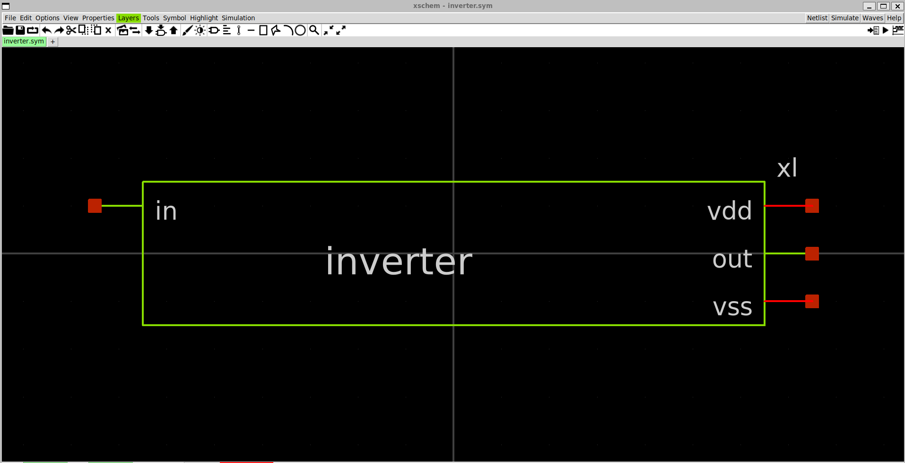
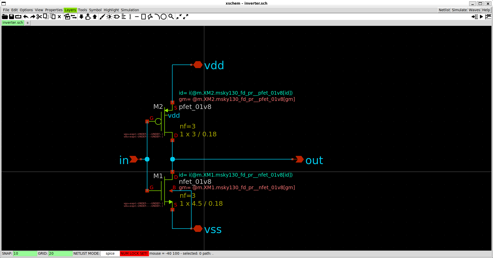
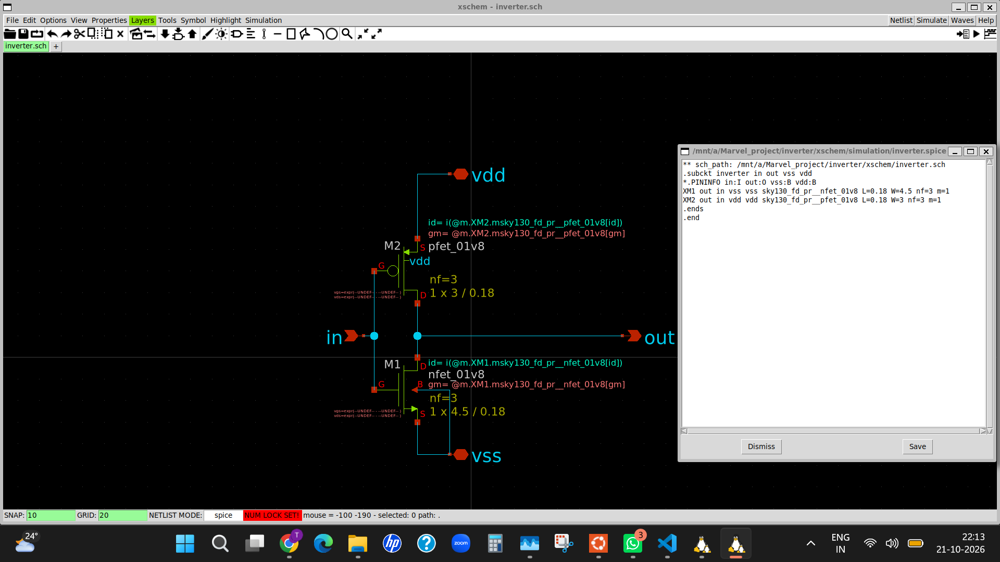
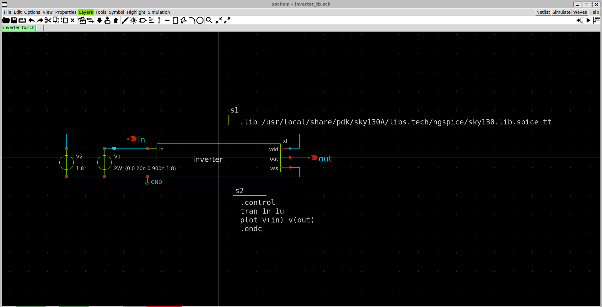
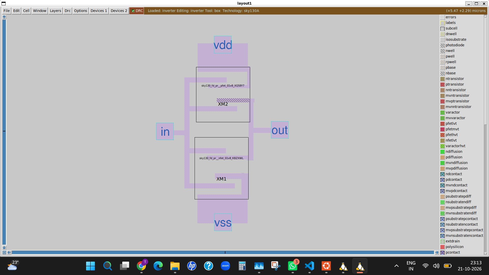
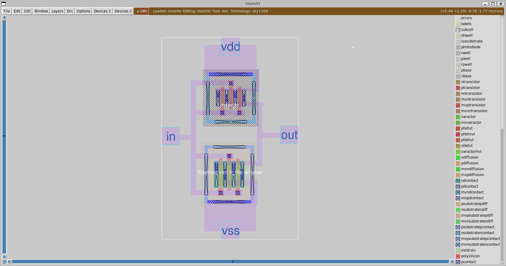
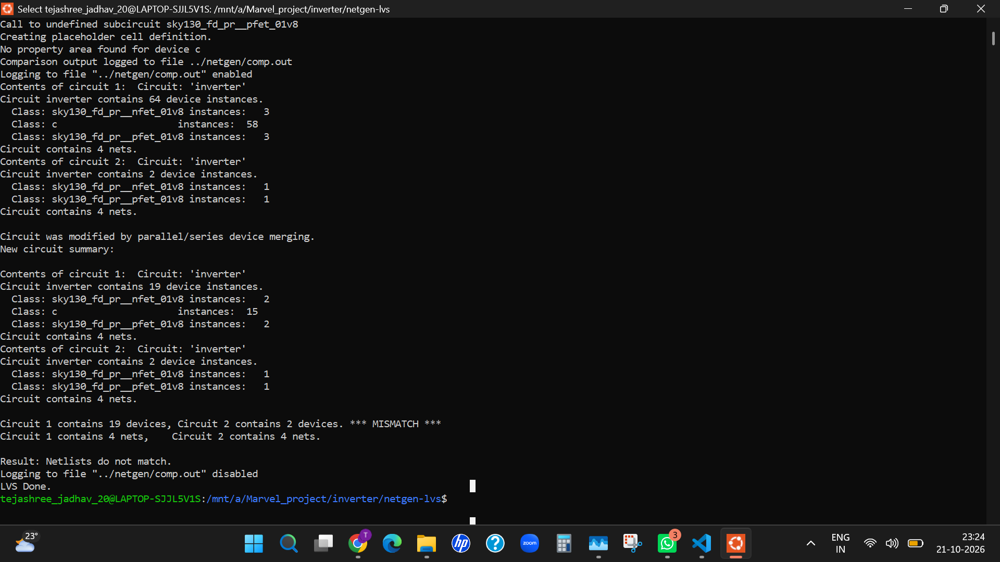

# SKY130 CMOS Inverter — Marvel_VSD

This project documents the design and verification of a CMOS inverter using the **SkyWater SKY130 PDK** and open-source EDA tools. Development is performed in Ubuntu under WSL on Windows.

**Repository:** [Tejashreegj/Marvel_VSD](https://github.com/Tejashreegj/Marvel_VSD)  
**Project directory:** `inverter/`

## Project overview

A CMOS inverter is a basic digital circuit built from one PMOS transistor and one NMOS transistor. Its output is the logical complement of its input.

## Project structure

```text
inverter/
├── inverter/images/
│   ├── inverter_schematic.png
│   ├── inverter_schematic_netlist.png
│   ├── inverter_simulation.png
│   ├── inverter_simulation_1.png
│   ├── inverter_symbol.png
│   ├── inverter_tb_schematic.png
│   └── inverter_tb_schematic_netlist.png
├── xschem/
│   ├── inverter.sch
│   ├── inverter.sym
│   ├── inverter_tb.sch
│   └── simulation/
├── mag/
│   └── inverter.mag
├── netgen-lvs/
│   └── setup.tcl
├── netgen/
│   └── comp.out
└── README.md
```

## Design and verification workflow

### 1. CMOS inverter symbol

The inverter symbol represents the logical input and output interface of the circuit.



### 2. Open the schematic in Xschem

From the project directory:

```bash
cd /mnt/a/Marvel_project/inverter
xschem xschem/inverter.sch
```

#### Inverter schematic



#### Generated inverter schematic netlist



Open the testbench:

```bash
xschem xschem/inverter_tb.sch
```

#### Inverter testbench schematic



#### Generated testbench netlist


#### Simulation waveform


Use the waveforms to check whether the output switches opposite to the input. Actual timing depends on transistor models, device dimensions, load, input source, and simulation settings.

### 3. Inspect the layout in Magic

Open the layout using the SKY130 technology file, if installed at the following path:

```bash
magic -T /usr/local/share/pdk/sky130A/libs.tech/magic/sky130A.tech mag/inverter.mag
```

If the PDK path differs, use the correct technology file. Inspect transistor regions, wells, contacts, interconnect, and input/output/power/ground connections.

#### 4. Inverter Layout



#### Inverter Layout Expanded




### 5. Run Netgen LVS

#### LVS result



